# loop-kit

**Un bucle de construcción autónomo para [Claude Code](https://docs.anthropic.com/en/docs/claude-code) que puedes dejar trabajando días.**
Planificas el producto con Claude en una sesión interactiva; después, un pequeño arnés en bash lo construye feature a
feature. Cada feature la valida un comando que ejecuta el propio arnés y la audita un agente de QA aparte, escéptico.
Incluye un roadmap en vivo, un vigilante de uso para planes de suscripción, una demo siempre al día y una prueba de
"usuario real" automática al final.

[Read in English](README.md)

<p align="center">
  <a href="https://jonjunq.github.io/loop-kit/diagrams/how-it-works.es.html">
  <picture>
    <source media="(prefers-color-scheme: dark)" srcset="docs/diagrams/how-it-works-dark.es.svg">
    
  </picture>
  </a>
</p>

<sub>Versión interactiva (zoom, claro/oscuro, seguir un camino): [ábrela en el navegador](https://jonjunq.github.io/loop-kit/diagrams/how-it-works.es.html). Dibujado con [Archify](https://github.com/tt-a1i/archify).</sub>

## Por qué otro bucle

La mayoría de bucles "Ralph" dejan que el agente decida cuándo ha terminado. Un agente que se corrige a sí mismo es
optimista, así que este arnés nunca le deja llevar la cuenta:

- **El arnés elige el trabajo y guarda el estado.** `features.json` solo lo escribe el arnés (y, con validación, el
  replanner). Un agente que se marca como hecho se revierte.
- **Hecho significa que pasa un comando.** Cada feature lleva un `verify` de shell (sus tests) que el arnés ejecuta
  sin ningún agente delante, y después una sesión de QA independiente que busca trampas (tests vacíos, mocks que
  esquivan la lógica, asserts rebajados) y cuyos cambios se descartan.
- **No da vueltas en vacío.** Los intentos fallidos, los atascos y las dependencias imposibles activan un replanner
  que solo puede tocar el plan; si los replanes no avanzan, bloquea la feature o para el bucle y te avisa. Cada 10
  features se vuelven a ejecutar todos los verify anteriores para cazar regresiones.
- **Revisa el conjunto, no solo cada pieza.** Al acabarse las features, unos revisores de seguridad de solo lectura
  miran el proyecto como lo haría un atacante y unos probadores lo usan como gente real; un triaje convierte lo que
  es real en features nuevas.
- **Está hecho para días, no minutos**: pausa y reanudación limpias para tus cambios, vigilante de la ventana de uso,
  tope de gasto, avisos, un roadmap con hora de fin que aprende del ritmo real del proyecto y una demo que siempre
  enseña la última feature que pasó.

### En uso real

loop-kit se desarrolló sobre un producto real: una PWA social planificada en una entrevista y construida por el
bucle en menos de 2,5 días de reloj (contando pausas por uso y los cambios del dueño).

| | |
|---|---|
| Features | 132 construidas y pasando (117 del plan, 2 de cambios del dueño, 13 de la prueba de usuario), 0 bloqueadas, 0 replanes |
| Sesiones de agente | 343 (171 worker, 172 QA), 372 $ en equivalente de API con una suscripción Max |
| Fallos que cazó el QA con los tests ya en verde | 10 |
| Regresiones cazadas por los barridos | 1 |
| Primera prueba de usuario (4 probadores con navegador) | 12 grupos de fallos que el bucle había dado por buenos, arreglados en 12 features + una regresión |
| Error de la hora de fin del roadmap | ±13 % aproximadamente |

Más en [docs/case-study.md](docs/case-study.md) (en inglés).

## Requisitos

- Linux (o WSL2 / macOS con coreutils de GNU, sin probar) con `bash`, `git`, `jq`, `curl`, `python3` (3.8+), `flock`,
  `timeout` y `tmux`. Node solo si tu stack o tus tests e2e lo usan.
- **Claude Code** con sesión iniciada, con suscripción (Pro, Max, Team…) o con clave de API. Mira
  [docs/plans-and-costs.md](docs/plans-and-costs.md): una construcción larga gasta muchos tokens.
- **Una máquina aislada** para el bucle: una VM, un contenedor LXC, una VM en la nube o la imagen Docker de
  `docker/`, con un usuario normal. Los agentes trabajan solos y con permisos amplios: lee
  [docs/isolation.md](docs/isolation.md).

## Empezar

```bash
# 1. Descarga el kit (donde quieras) y revisa la máquina
git clone https://github.com/jonjunq/loop-kit ~/loop-kit
~/loop-kit/loopkit doctor

# 2. Instálalo en un proyecto nuevo o ya empezado
~/loop-kit/loopkit init ~/miapp
cd ~/miapp && nano loopkit.env          # modelo, permisos, presupuesto, avisos

# 3. Planifica, en interactivo (es la parte que decide si sale bien)
claude --model opus
#   > Lee loopkit/prompts/PLAN.md y sigue sus instrucciones.
# Responde la entrevista, di "genera", revisa SPEC.md y features.json.

# 4. Lanza: una sesión de tmux con el bucle, el roadmap (http://<host>:8090) y el vigilante
./loopkit/tmux.sh && tmux attach -t loop
#   el vigilante (AUTO_RESUME=1) arranca ./loopkit/run.sh en la ventana "loop" en menos de un minuto, y otra
#   vez cada vez que hay trabajo nuevo; Ctrl+B D para salir, tmux attach -t loop para volver
```

Para que sobreviva a los reinicios, instala la unidad de systemd de usuario de `loopkit/templates/loopkit-tmux.service`
(las instrucciones van dentro). ¿Prefieres llevarlo tú? `tmux new -s loop` y lanza `./loopkit/run.sh`,
`./loopkit/roadmap.sh` y `./loopkit/guard.sh` en tres ventanas; sin `AUTO_RESUME=1` el vigilante solo mira el uso.

Antes de lanzar, prueba a mano dos o tres `verify` (`bash -c "<verify>"`): ahora deben FALLAR (aún no hay código) y
no deben quedarse colgados.

**Idioma:** los prompts están en inglés, pero el planificador te habla en tu idioma y en la entrevista pregunta en
qué idiomas va el proyecto (interfaz, documentación, código). Los agentes los siguen, así que tu app y su
documentación pueden salir en castellano. Los mensajes del arnés (`logs/loop.log` y los avisos) van en inglés; el
roadmap se muestra en castellano si tu navegador lo está (o con `?lang=es`).

## Día a día

| Quieres… | Haz |
|---|---|
| Parar y que siga parado | `touch STOP` (acaba la iteración en curso). Reanudar: `rm STOP` (el vigilante lo vuelve a arrancar) |
| Cambiar algo a mitad | `claude` en el proyecto: `Lee loopkit/prompts/CHANGE.md y aplica este cambio: …` Pausa el bucle (`PAUSE`), cambia SPEC y features, hace commit y lo reanuda, sin relanzar a mano |
| Enseñar la app mientras se construye | `./loopkit/demo.sh` (necesita `demo.env`, que escribe el planificador) |
| Saber cuándo acabará | el roadmap: avance por bloques, Gantt, hora de fin con horquilla, uso, últimas notas |
| Recibir avisos | `NTFY_TOPIC` o `NOTIFY_CMD` en `loopkit.env` ([docs/notifications.md](docs/notifications.md)): Telegram, Discord, Slack, webhooks |
| Guardarte parte de tu cuota | el vigilante para el bucle al 80 % de la ventana de 5 h y lo vuelve a arrancar al renovarse |
| No relanzar nunca a mano | el vigilante con `AUTO_RESUME=1` arranca el bucle siempre que hay trabajo: features pendientes o un commit nuevo después de terminar (un cambio). Si se cae 3 veces nada más arrancar, deja de intentarlo hasta el siguiente commit y te avisa |
| Poner un tope de gasto | `BUDGET_USD` en `loopkit.env` |
| Revisar su seguridad | automático al acabarse las features, antes de la prueba de usuario (`SECURITY_ROUNDS`, activado por defecto) |
| Probarla como un usuario | automático al acabarse las features (necesita `usertest.env`); a mano con `prompts/USERTEST.md` |
| Actualizar el kit | `~/loop-kit/loopkit update ~/miapp` (pausa antes el bucle) |
| Retomar tras un corte o reinicio | con el vigilante en marcha se reanuda solo (con la unidad de systemd, también tras reiniciar); si no, `./loopkit/run.sh` sigue desde el estado en disco |
| Adoptar un proyecto a medias | `loopkit init` en su carpeta: el planificador estudia el código y solo planifica lo que falta |

## Documentación (en inglés)

- [Cómo funciona](docs/how-it-works.md): papeles, ficheros, redes de seguridad, la revisión de seguridad y la prueba de usuario.
- [Configuración](docs/configuration.md): todos los ajustes y ficheros.
- [Planes y costes](docs/plans-and-costs.md): suscripción o API, vigilante de uso, tope de gasto, qué modelos usar.
- [Aislamiento y seguridad](docs/isolation.md): dónde ejecutarlo y cómo cerrarlo.
- [Avisos](docs/notifications.md): ntfy, Telegram, Discord, Slack, webhooks y cómo dejar los tokens fuera del sandbox.
- [Guía de trabajo](docs/workflow.md): planificar bien, diseño primero, cambios, demo, adoptar un proyecto existente.
- [Caso real](docs/case-study.md) y [Problemas frecuentes](docs/troubleshooting.md).

## Créditos

- El diseño del arnés sigue el artículo de Anthropic
  [harness design for long-running apps](https://www.anthropic.com/engineering/harness-design-long-running-apps)
  (evaluador independiente, separar quien genera de quien evalúa) y la idea del bucle "Ralph".
- Reglas de "código mínimo" de `prompts/WORKER.md`: adaptadas de [Ponytail](https://github.com/DietrichGebert/ponytail) (MIT).
- Entrevista con apuesta por pregunta, "fuera de alcance" obligatorio, límites en la SPEC y tests primero: ideas de
  [addyosmani/agent-skills](https://github.com/addyosmani/agent-skills) (MIT).
- "Recorre cada botón hasta el final" de los probadores: adaptado de `click-path-audit` de
  [everything-claude-code](https://github.com/affaan-m/everything-claude-code) (MIT).
- Revisión de seguridad: "un hallazgo cruza una frontera de confianza real" y "el triaje intenta refutar cada
  hallazgo" siguen a [cloudflare/security-audit-skill](https://github.com/cloudflare/security-audit-skill) (MIT).

Sin relación con Anthropic. Licencia MIT, ver [LICENSE](LICENSE).
