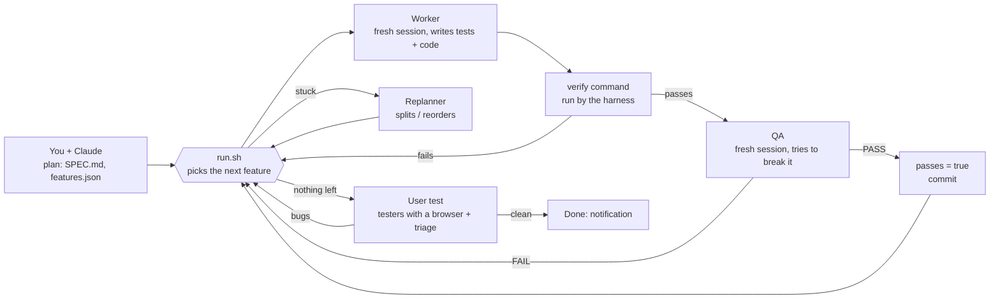

# loop-kit

**An autonomous build loop for [Claude Code](https://docs.anthropic.com/en/docs/claude-code) that you can leave running for days.**
You plan the product with Claude in one interactive session; then a small bash harness builds it feature by feature,
with every feature checked by a command the harness runs itself and audited by a separate, sceptical QA agent.
It comes with a live roadmap, a usage guard for subscription plans, an always-up-to-date demo and an automatic
"real user" test at the end.

[Leer en castellano](README.es.md)



## Why another loop

Most "Ralph" loops let the agent decide when a task is done. Agents grading their own homework are optimists, so
this harness never trusts them with the score:

- **The harness picks the work and keeps the state.** `features.json` is only written by the harness (and, under
  validation, by the replanner). An agent that marks itself done gets reverted.
- **Done means a command passes.** Each feature carries a shell `verify` (its tests) that the harness runs with no
  agent around, followed by an independent QA session that looks for cheating (empty tests, mocks that dodge the
  logic, weakened assertions) and is thrown away afterwards.
- **It does not spin.** Failed attempts, stalls and dependency deadlocks trigger a replanner that may only touch the
  plan; replans that make no progress block the feature or stop the loop and call you. Every 10 features all
  previous verifies are re-run to catch regressions.
- **It is built for days, not minutes**: clean pause/resume for your changes, usage-window guard, budget cap,
  notifications, a roadmap with an ETA that learns from the project's real pace, and a demo that always shows the
  latest passing feature.

### In real use

loop-kit was developed on a real product: a PWA social app planned in one interview and built by the loop in under
2.5 days of wall time (usage pauses and the owner's changes included).

| | |
|---|---|
| Features | 132 built and passing (117 from the plan, 2 from owner changes, 13 from the user test), 0 blocked, 0 replans |
| Agent sessions | 343 (171 worker, 172 QA), $372 API-equivalent on a Max subscription |
| Bugs the QA caught after the tests had passed | 10 |
| Regressions caught by the sweeps | 1 |
| First user test (4 browser testers) | 12 groups of bugs the loop had considered done, fixed in 12 features + a regression |
| Roadmap ETA error | about ±13 % |

More in [docs/case-study.md](docs/case-study.md).

## Requirements

- Linux (or WSL2 / macOS with GNU coreutils, untested) with `bash`, `git`, `jq`, `curl`, `python3` (3.8+), `flock`,
  `timeout` and `tmux`. Node only if your stack or your end-to-end tests need it.
- **Claude Code**, logged in with a subscription (Pro, Max, Team…) or an API key. See
  [docs/plans-and-costs.md](docs/plans-and-costs.md): a long build uses a lot of tokens.
- **An isolated machine** for the loop: a VM, an LXC container, a cloud VM or the Docker image in `docker/`, with a
  normal user. The agents run unattended with broad permissions; read [docs/isolation.md](docs/isolation.md).

## Quick start

```bash
# 1. Get the kit (anywhere) and check the machine
git clone https://github.com/jonjunq/loop-kit ~/loop-kit
~/loop-kit/loopkit doctor

# 2. Install it in a new or existing project
~/loop-kit/loopkit init ~/myapp
cd ~/myapp && nano loopkit.env          # model, permissions, budget, notifications

# 3. Plan, interactively (this is the part that decides whether it goes well)
claude --model opus
#   > Read loopkit/prompts/PLAN.md and follow it.
# Answer the interview, say "generate", review SPEC.md and features.json.

# 4. Launch: a tmux session with the loop, the roadmap (http://<host>:8090) and the guard
./loopkit/tmux.sh && tmux attach -t loop
#   the guard (AUTO_RESUME=1) starts ./loopkit/run.sh in the "loop" window within a minute, and again
#   whenever there is new work; Ctrl+B D to detach, tmux attach -t loop to come back
```

To survive reboots, install the systemd user unit in `loopkit/templates/loopkit-tmux.service` (instructions inside).
Prefer to drive it yourself? `tmux new -s loop` and run `./loopkit/run.sh`, `./loopkit/roadmap.sh` and
`./loopkit/guard.sh` in three windows; without `AUTO_RESUME=1` the guard only watches usage.

Before launching, try two or three `verify` commands by hand (`bash -c "<verify>"`): they must FAIL now (there is
no code yet) and must not hang.

## Day to day

| You want to… | Do |
|---|---|
| Stop, and stay stopped | `touch STOP` (it finishes the current iteration). Resume: `rm STOP` (the guard starts it again) |
| Change something mid-build | `claude` in the project: `Read loopkit/prompts/CHANGE.md and apply this change: …` It pauses the loop (`PAUSE`), edits SPEC/features, commits and resumes it, no relaunch needed |
| Show the app while it is being built | `./loopkit/demo.sh` (needs `demo.env`, written by the planner) |
| Know when it will finish | the roadmap: progress by block, Gantt, ETA with range, usage, the latest notes |
| Get notified | `NTFY_TOPIC` or `NOTIFY_CMD` in `loopkit.env` ([docs/notifications.md](docs/notifications.md)) |
| Keep part of your quota | the guard stops the loop at 80 % of the 5-hour window and starts it again when it renews |
| Never relaunch by hand | the guard with `AUTO_RESUME=1` starts the loop whenever there is work: pending features, or a new commit after it finished (a change). If it dies 3 times right after starting, it stops trying until the next commit and tells you |
| Cap the spend | `BUDGET_USD` in `loopkit.env` |
| Test it like a user | automatic when the features run out (needs `usertest.env`); by hand with `prompts/USERTEST.md` |
| Update the kit | `~/loop-kit/loopkit update ~/myapp` (pause the loop first) |
| Resume after a crash or reboot | with the guard running it resumes by itself (with the systemd unit, after a reboot too); otherwise `./loopkit/run.sh` continues from the state on disk |

## Documentation

- [How it works](docs/how-it-works.md): roles, files, safety nets, the user test.
- [Configuration](docs/configuration.md): every setting and every file.
- [Plans and costs](docs/plans-and-costs.md): subscriptions vs API, the usage guard, the budget cap, choosing models.
- [Isolation and security](docs/isolation.md): where to run it and how to lock it down.
- [Notifications](docs/notifications.md): ntfy, Telegram, Discord, Slack, webhooks, and keeping tokens out of the sandbox.
- [Workflow guide](docs/workflow.md): planning well, design first, changes, demo, adopting an existing project.
- [Case study](docs/case-study.md) and [Troubleshooting](docs/troubleshooting.md).

## Repository layout

```
loopkit                 CLI: init / update / doctor
kit/                    what gets installed into <project>/loopkit/
  run.sh                the harness
  prompts/              PLAN, WORKER, QA, REPLAN, CHANGE, TESTER, TRIAGE, USERTEST
  roadmap/  roadmap.sh  live roadmap (stdlib Python + one HTML file)
  guard.sh              usage guard (subscription plans) and auto-start
  tmux.sh               creates the tmux session (loop, roadmap, guard, demo); templates/ has a systemd unit for boot
  demo.sh               always-up-to-date demo
  notify.sh lib.sh      settings and notifications
  templates/            loopkit.env, demo.env, usertest.env, design README, systemd unit
examples/               notification scripts and a remote notification watcher
docker/                 an isolated runner image
tests/                  end-to-end tests of the harness with a fake Claude
```

## Credits

- The harness design follows Anthropic's
  [harness design for long-running apps](https://www.anthropic.com/engineering/harness-design-long-running-apps)
  (independent evaluator, generator/evaluator split) and the "Ralph" loop idea.
- "Minimal code" rules in `prompts/WORKER.md`: adapted from [Ponytail](https://github.com/DietrichGebert/ponytail) (MIT).
- Interview with a bet per question, mandatory out-of-scope list, boundaries in the SPEC, tests first: ideas from
  [addyosmani/agent-skills](https://github.com/addyosmani/agent-skills) (MIT).
- "Follow every button to the end" in the tester prompts: adapted from `click-path-audit` in
  [everything-claude-code](https://github.com/affaan-m/everything-claude-code) (MIT).

Not affiliated with Anthropic. MIT licensed, see [LICENSE](LICENSE).
